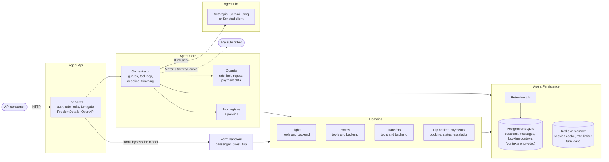
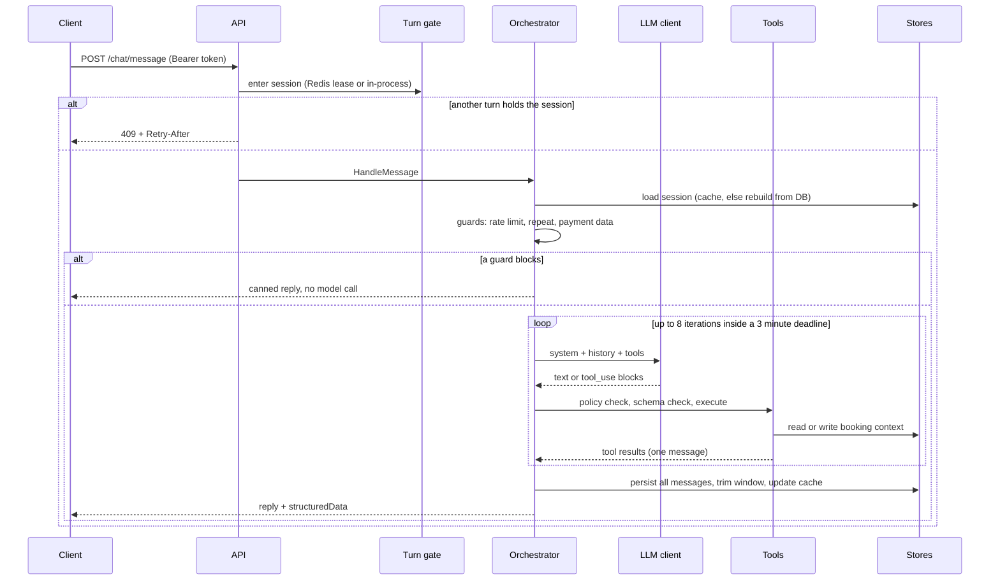

# llm-booking-agent

An LLM-orchestrated booking assistant **backend**. A user chats over REST; the assistant searches flights, hotels and
airport transfers, confirms prices, builds a multi-service trip, collects traveller details through server-side forms
(never in chat), takes the booking to payment and reports its status. There is no UI: the product surface is an HTTP
API with a committed OpenAPI document.

The interesting part is not the happy path but the engineering around it:

- a provider-agnostic agent loop (Anthropic, Gemini, Groq, or a scripted model) with tools, policies and a bounded,
  cancellable turn;
- hard server-side safety: money and identity never come from the model;
- guards in front of the model (rate limit, repeated messages, payment data);
- durable conversation state that a cache miss rebuilds faithfully, tool blocks included;
- operations basics: a distributed turn lock, signing-key rotation, encryption of stored traveller details, a retention
  job and metrics;
- deterministic testing through a scripted model, so whole conversations run end to end without any provider.

Backends (suppliers, payments) are in-memory fakes behind ports; see [Known limits](#known-limits) and
[Roadmap](#roadmap) for what is deliberately not built.

## Architecture



A user message takes this path:



### Safety model in one paragraph

Submit tools take no arguments. They read the selected item, the confirmed price and the traveller details from the
server-side booking context, which is written only by supplier-backed tools (`recheck_flight_price`, `prebook_room`,
`select_transfer`) and by the form endpoints. A policy refuses submission unless the price was confirmed in this session
and is fresh. Every submit has a persisted idempotency key, so replays return the same booking. The trip basket is a
booking context of its own: which services may be in it is decided by the server, not by the model. Tool output is
stripped of configured properties and wrapped in delimiters before the model sees it, and the system prompt states
that everything inside is data, not instructions. See
[ADR 0003](docs/adr/0003-model-never-owns-money-or-identity.md) and
[ADR 0007](docs/adr/0007-trip-basket-invariants.md).

## Project layout

```
LlmBookingAgent.slnx
src/
  Agent.Abstractions       neutral DTOs and ports (no dependencies)
  Agent.Core               orchestrator, tool registry, policies, guards, prompt builder, trimming, forms, language, telemetry
  Agent.Llm                AnthropicChatClient, GeminiChatClient, GroqChatClient, ScriptedLlmClient
  Agent.Persistence        EF Core (Npgsql + SQLite), Postgres migrations, Redis and in-memory cache, rate limiters,
                           Redis turn lease, retention job, encryption of booking contexts
  Agent.Domains.Shared     trip basket and trip tools, payment methods, booking submission and status, escalation (fakes behind ports)
  Agent.Domains.Flights    7 flight tools, passenger form, in-memory backend, sample HTTP supplier adapter
  Agent.Domains.Hotels     6 hotel tools, guest form, in-memory backend
  Agent.Domains.Transfers  4 transfer tools, in-memory backend
  Agent.Api                ASP.NET Core minimal API
tests/
  Agent.Tests              unit tests (no Docker)
  Agent.IntegrationTests   API tests through WebApplicationFactory (SQLite and in-process fakes)
demo/demo-script.json      the scripted conversation used by the end-to-end test and the walkthrough
docs/openapi.json          generated OpenAPI document (a test fails if it drifts)
docs/adr/                  architecture decision records
requests/chat.http         one working request per endpoint, plus the full flight, hotel and trip walkthrough
.github/workflows/ci.yml   build, tests, OpenAPI check
```

## Run it

```bash
dotnet run --project src/Agent.Api -- --environment Development --urls http://localhost:5101
curl -s -X POST localhost:5101/api/v1/chat/start -H "X-Client-Key: dev-client-key-0123456789" -H "Content-Type: application/json" -d '{"locale":"en"}'
```

Development uses SQLite (`agent-dev.db`), the in-process cache and turn gate, and the scripted model, with fake keys
from `appsettings.Development.json`. Open [`requests/chat.http`](requests/chat.http) in VS Code with the REST Client
extension to walk through the flight flow, the hotel flow, the multi-service trip (flight, hotel and transfer with one
combined form and one payment), the forms and an escalation. Rider's HTTP client runs the plain requests too, but the
chained `{{start.response...}}` variables are REST Client syntax. The demo uses the `Scripted` provider, which plays
[`demo/demo-script.json`](demo/demo-script.json): each message advances the script by one turn, so send the messages in
order, once per session.

### Using a real model

For any provider set the configuration keys directly (environment variable form shown):

| Provider | Settings |
| --- | --- |
| Anthropic | `Llm__Provider=Anthropic`, `Anthropic__ApiKey`, optional `Anthropic__Model` (default `claude-sonnet-5-5`) |
| Gemini | `Llm__Provider=Gemini`, `Gemini__ApiKey`, optional `Gemini__Model` (default `gemini-2.5-flash`) |
| Groq | `Llm__Provider=Groq`, `Groq__ApiKey`, `Groq__Model` (required, no default; the choice is always explicit) |

Keys are read from configuration only and are never logged (Gemini's goes in a header, never in the URL). The switch is
manual and read once at startup; there is no automatic failover, see [ADR 0005](docs/adr/0005-manual-provider-switch.md).
`Agent:Temperature` is unset by default and then omitted from the request, because current Claude models reject
non-default sampling parameters; set it (for example `Agent__Temperature=0`) only for a model that accepts it. The
prompt-cache layout (breakpoints on the stable system block, the last tool and the last message) is Anthropic-specific;
the other clients do not set cache controls. All three clients are verified against recorded-style request and response
fixtures; the test suite never calls a live API.

## Tests

```bash
dotnet test                                          # everything; no Docker or other service is needed
dotnet test tests/Agent.Tests                        # the unit project only
dotnet test tests/Agent.IntegrationTests             # the API project only (WebApplicationFactory)
```

All tests run in process. They use fake clocks (`TimeProvider`), a scripted model, in-memory fakes and a throw-away
SQLite database; the API tests go through `WebApplicationFactory`. See "Known limits" for what that leaves untested.

The tests use the `xunit.v3.mtp-off` package so that the classic `dotnet test` and `--filter` work on .NET SDK 10
(the default xUnit v3 package targets Microsoft.Testing.Platform, which the SDK 10 `dotnet test` rejects).

`docs/openapi.json` is generated from the running API and compared byte for byte in a test. After an intended API
change, regenerate it with:

```bash
UPDATE_OPENAPI=1 dotnet test tests/Agent.IntegrationTests --filter "FullyQualifiedName~OpenApiSnapshot"
```

(PowerShell: `$env:UPDATE_OPENAPI=1; dotnet test tests/Agent.IntegrationTests --filter "FullyQualifiedName~OpenApiSnapshot"`.)

[`.github/workflows/ci.yml`](.github/workflows/ci.yml) runs restore, `dotnet build -warnaserror`, the tests and the
OpenAPI snapshot check. It uses no secrets and deploys nothing.

## API overview

All routes are versioned under `/api/v1`. Errors are RFC 7807 `application/problem+json`; stack traces are never
returned. Every response carries `X-Correlation-Id` (accepted if well-formed, otherwise generated).

| Method and path | Auth | Purpose | Notable statuses |
| --- | --- | --- | --- |
| `POST /chat/start` | `X-Client-Key` | Start a session, mint a signed session token, return greeting, `locale`, `direction` | 201, 401, 422, 429 |
| `POST /chat/message` | Bearer | Send a message (max 2000 characters). Returns `reply`, `locale`, `direction`, `state`, `structuredData[{state,data}]` | 200, 401, 404, 409 (+ `Retry-After`), 410, 422, 429 (+ `Retry-After`) |
| `GET /chat/history` | Bearer | Visible messages, oldest first (`limit` 1 to 200) | 200, 404, 410, 422 |
| `DELETE /chat/session` | Bearer | End the session and erase its messages and booking data | 204, 404 |
| `POST /chat/forms/passenger` | Bearer | Submit the flight passenger form (bypasses the model) | 200, 409, 410, 422 |
| `POST /chat/forms/guest` | Bearer | Submit the hotel guest form (bypasses the model) | 200, 409, 410, 422 |
| `POST /chat/forms/trip` | Bearer | Submit the one combined traveller form of a multi-service trip (bypasses the model); the same person entered twice is a 422 | 200, 409, 410, 422 |
| `GET /bookings/{bookingId}/status` | Bearer | Status of a booking made in this session (single-service or trip) | 200, 404 |
| `GET /lookups/countries` | none | ISO country codes and names used by the forms | 200 |
| `GET /tools` | `X-Client-Key` | Registered tool definitions, in prompt order | 200, 401 |
| `GET /health/live`, `GET /health/ready` | none | Liveness; readiness checks Postgres and Redis (when configured) | 200, 503 |
| `GET /openapi/v1.json` | none | The OpenAPI document | 200 |

The health endpoints are operational endpoints and are **deliberately not part of the OpenAPI document**
(`docs/openapi.json` describes the ten chat, booking, lookup and tool routes).

Status mapping: unknown session 404, idle-expired session 410, a second message or form for a session whose turn is
still running 409 with `Retry-After` (`Turn:ContentionRetryAfterSeconds`, default 2), validation 422, throttled 429
with `Retry-After`. Session tokens are HMAC-signed, carry a key id, are bound to one session and expire; see
[ADR 0006](docs/adr/0006-signed-session-token.md).

## Tools

The assistant has 25 tools (the live registry behind `GET /api/v1/tools` returns this many), registered through DI and
listed in a stable ordinal order so the prompt prefix stays cache friendly. Every input is validated against its JSON
schema before execution, and none takes a price, a traveller or a payment detail from the model.

| Area | Tools | Notes |
| --- | --- | --- |
| Flights (7) | `search_flights`, `filter_flight_offers`, `get_flight_details`, `get_branded_fares`, `recheck_flight_price`, `collect_passenger_details`, `submit_flight_booking` | `recheck_flight_price` records the live price; `submit_flight_booking` takes no arguments |
| Hotels (6) | `search_hotels`, `filter_hotels`, `get_hotel_rooms`, `prebook_room`, `collect_guest_details`, `submit_hotel_booking` | `prebook_room` records the re-quoted price; `submit_hotel_booking` takes no arguments |
| Transfers (4) | `search_transfers`, `get_transfer_details`, `get_transfer_price`, `select_transfer` | `select_transfer` re-quotes and records the price; transfers are booked through the trip |
| Trip basket (5) | `add_to_trip`, `view_trip`, `remove_from_trip`, `collect_trip_details`, `submit_trip_booking` | The server decides which services may be added; one form, one booking, one payment |
| Shared (3) | `get_payment_methods`, `get_booking_status`, `escalate_to_human` | Escalation writes a request and an audit row; the session becomes `Escalated` |

## Configuration

Options are validated at startup (`ValidateOnStart`); a bad value fails fast with a clear message.

| Setting | Default | Meaning |
| --- | --- | --- |
| `Llm:Provider` | `Anthropic` | `Scripted`, `Anthropic`, `Gemini` or `Groq`. Manual switch, no failover. `Scripted` also needs `Llm:Scripted:ScriptPath` |
| `Anthropic:ApiKey`, `:Model`, `:TimeoutSeconds` | none, `claude-sonnet-5-5`, 60 | Required for the Anthropic provider |
| `Gemini:ApiKey`, `:Model`, `:TimeoutSeconds` | none, `gemini-2.5-flash`, 60 | Required for the Gemini provider |
| `Groq:ApiKey`, `:Model`, `:TimeoutSeconds` | none, none (required), 30 | Required for the Groq provider (chat-completions API) |
| `Persistence:Provider`, `Persistence:MigrateOnStartup` | `Postgres`, `true` | `Postgres` or `Sqlite`; connection strings under `ConnectionStrings:Postgres` / `:Sqlite` |
| `ConnectionStrings:Redis` | unset | When set, Redis backs the session cache, the session rate limiter and the turn lease; otherwise memory and the in-process gate |
| `Session:IdleTtlMinutes` | 30 | One setting for the cache TTL and for when a session counts as expired |
| `Turn:LeaseSeconds`, `Turn:ContentionRetryAfterSeconds` | 60, 2 | Redis turn lease (renewed while a turn runs; a crashed holder blocks its session for at most one lease) and the `Retry-After` of the 409. See [ADR 0008](docs/adr/0008-distributed-turn-lock.md) |
| `RateLimiting:*` | 30 messages/min/session, 120/min/IP, 60 starts/min/key | Enforcement is on by default |
| `Auth:ClientKeys` | none | Integrator keys for `POST /chat/start` and `GET /tools` (at least one, 16+ characters each) |
| `Auth:SessionTokenSigningKey`, `Auth:SessionTokenKeyId` | none, `k1` | Current signing key (32+ characters) and its id (the token `kid`) |
| `Auth:PreviousSessionTokenKeys` | empty | Rotation: earlier keys, each with `KeyId`, `Key` and a required `RetiresAt`; they verify old tokens until then and never sign |
| `Auth:SessionTokenLifetimeMinutes` | 120 | Token lifetime, regardless of activity |
| `DataProtection:KeyRingPath` | unset | Folder of the key ring that encrypts stored booking contexts. Required in Production. See [ADR 0009](docs/adr/0009-encryption-at-rest.md) |
| `Retention:Enabled`, `:RunIntervalMinutes`, `:GraceMinutes` | `true`, 15, 60 | Sessions idle longer than `Session:IdleTtlMinutes` plus the grace are purged with their messages and booking contexts |
| `Retention:BatchSize`, `:MaxBatchesPerRun` | 100, 50 | One delete statement per batch; a run stops at its batch limit and the next run continues |
| `Trip:AllowedServices`, `Trip:MaxServices` | flight, hotel, transfer; 3 | Server-side allow-list and size limit of the trip basket |
| `Agent:AssistantName`, `:Currency`, `:TimeZone`, `:DefaultLocale` | `Aria`, `EUR`, `UTC`, `en` | No region-specific behaviour |
| `Agent:HistoryWindow`, `:TrimChunk` | 20, 8 | Prompt window; trimmed in chunks so the cached prefix stays stable |
| `Agent:MaxToolIterations`, `:TurnTimeoutSeconds`, `:MaxMessageLength`, `:MaxTokens` | 8, 180, 2000, 1024 | Turn bounds |
| `Agent:PriceConfirmationMaxAgeMinutes`, `:SearchMaxAgeMinutes` | 15, 30 | How long a confirmed price and a search snapshot stay usable |
| `Agent:Temperature` | unset | Sampling temperature; omitted from the request when unset |
| `Backends:Flights:Provider`, `Backends:Fake:AutoConfirmAfterSeconds` | `InMemory`, 30 | Flight backend (`InMemory` or the sample `Http` adapter) and when the fake payment confirms a booking |

**Metrics.** The code publishes `System.Diagnostics.Metrics` instruments and `ActivitySource` spans (one per turn, one
per tool call) under the name `LlmBookingAgent`, and references no exporter. To export, subscribe by name, for example
`AddMeter("LlmBookingAgent")` and `AddSource("LlmBookingAgent")` on the OpenTelemetry builders in the host. Instruments
and tags are listed in [ADR 0010](docs/adr/0010-metrics-and-tracing.md); no message text or personal data is ever used
as a tag.

## What is proven where

Each row names the test classes that carry the claim. All of them run in process, without Docker.

| Claim | Test classes |
| --- | --- |
| The turn loop is bounded: iteration cap, deadline, caller abort versus timeout, truncated and blank replies, an LLM failure keeps history and a retry does not repeat a tool | `OrchestratorTurnTests` |
| Tool failures are recoverable: schema violations, policy denials and unknown tools come back to the model as error results; several tool calls produce one result message | `OrchestratorToolTests`, `ToolInputValidatorTests`, `ToolRegistryTests`, `ToolContractTests` |
| Policy pipeline: one search per turn (plus one corrected re-search), finalize only after a fresh confirmed price | `OrchestratorToolTests`, `FinalizeRequiresConfirmedPricePolicyTests` |
| Money and identity are server-owned: submit tools reject model-supplied prices and travellers and book the server-held price; double submit books once | `SubmitToolSchemaTests`, `SubmitInjectionTests`, `BookingSubmitterTests`, `TripCheckoutTests`, `ChatFlowTests` |
| Trip basket invariants: allow-list and size cap, no price stored in the basket, stale lines block checkout, traveller de-duplication, removal re-opens the form, one idempotent booking for all services | `TripBasketTests`, `TripCheckoutTests`, `ChatFlowTests` |
| Transfers follow the same pattern as flights and hotels | `TransferBackendTests`, `SearchTransfersToolTests`, `SelectTransferToolTests`, `TransferDetailsAndPriceToolTests` |
| Guards: card (BIN and Luhn), IBAN, keyword plus digits in English and Arabic, repeated messages, canned replies without a model call, guard order, PII masking | `SensitiveDataDetectorTests`, `SensitiveDataGuardTests`, `RepeatedMessageGuardTests`, `SessionRateLimitGuardTests`, `GuardPipelineTests`, `OrchestratorGuardTests`, `PiiMaskerTests` |
| Rate limiting: atomic window counters, enforcement on by default, 429 with `Retry-After` | `InMemorySessionRateLimiterTests`, `RateLimitDefaultsTests`, `ApiContractTests` |
| Booking-context race: concurrent first writes and updates are all applied and no unique violation leaks, including the trip row | `BookingContextStoreTests`, `TripBasketTests` |
| Faithful rebuild after a cache miss: tool blocks, requested services, repeat state and trimming window | `RebuildFidelityTests`, `OrchestratorRebuildTests`, `ChatFlowTests` |
| History trimming (pair-aware, chunked, orphan drop) and prompt-cache layout (breakpoints, byte-identical stable block) | `HistoryTrimmerTests`, `AnthropicCacheLayoutTests`, `SystemPromptBuilderTests`, `OrchestratorRebuildTests` |
| Prompt-injection corpus (see below) | `InjectionCorpusDataTests`, `ToolOutputSanitizerTests`, `SubmitInjectionTests` |
| Scripted end to end through the real API: flights, hotels, the multi-service trip, escalation | `ChatFlowTests`, `ScriptedLlmClientTests` |
| Provider clients: request translation, response parsing, tool-call round trips, error classification, retries | `AnthropicClientRequestTests`, `AnthropicClientResponseTests`, `AnthropicClientRetryTests`, `AnthropicErrorKindTests`, `GeminiRequestTests`, `GeminiSchemaTests`, `GeminiResponseTests`, `GeminiRoundTripTests`, `GeminiErrorTests`, `GroqRequestTests`, `GroqResponseTests`, `GroqRoundTripTests`, `GroqErrorTests`, `LlmErrorClassificationTests`, `RetryAfterTests`, `LlmProviderSwitchTests` |
| Turn lock: the in-process gate lets exactly one turn per session proceed and releases it; the Redis gate, against a mocked connection, sets the key with a random token and expiry, refuses when the key is held, releases and renews with its own token, and falls back to a process-local lock when Redis is unreachable; contention returns 409 with `Retry-After` (the Lua scripts and the lease against a real Redis are not exercised here) | `InProcessTurnGateTests`, `RedisTurnGateTests`, `TurnContentionAndMetricsApiTests` |
| Signing-key rotation: rotate, previous key retires, unknown `kid`, tampering, startup validation | `SessionTokenRotationTests` |
| Retention: expired rows gone, active sessions untouched, bounded batches, safe to run twice | `SessionRetentionTests`, `RetentionApiTests` |
| Encryption at rest: round trip, ciphertext in the column, tampering fails closed | `EncryptionAtRestTests`, `EncryptionApiTests` |
| Metrics and spans, with bounded tags and no personal data | `AgentTelemetryTests`, `TurnContentionAndMetricsApiTests` |
| No log suppression is configured | `RepositoryConfigurationTests` |
| API contract, status mapping and the OpenAPI snapshot | `ApiContractTests`, `OpenApiSnapshotTests`, `OptionsBindingTests` |
| Anti-corruption layer of the sample HTTP supplier adapter (GET-only retries, envelope normalisation) | `HttpFlightBackendTests` |

### What the injection corpus proves, and what it does not

`tests/Agent.Tests/Security/Corpus/injection-corpus.json` holds the cases; adding an entry adds a test case with no code
change. It has 10 hostile tool outputs (for example "ignore previous instructions", forged tool results, role spoofing,
forged closing delimiters, markup that looks like a tool call, template markers), 6 hostile user messages (including one
Arabic) and 14 attack tool calls (price or passenger arguments on submit tools, services the basket does not allow,
checkout with nothing confirmed). Four theories run them:

- Hostile tool output stays inside the data delimiters, cannot close them, and the server's own note stays outside.
- Hostile user text is stored and sent as exactly one plain user text block and never reaches the system prompt or
  becomes a tool block.
- A model that has been talked into an attack call is stopped by schema validation, the policy pipeline or the
  server-side basket, and neither the stored booking contexts nor the booking backend change.
- A valid checkout under hostile user text books exactly the server-held price.

The model in these tests is scripted. So the corpus proves that **the server-side controls hold even if the model is
fully compromised**: the model cannot change what is booked or what it costs. It does **not** prove that a real model
resists persuasion, and it says nothing about obfuscated or encoded payloads, multi-turn attacks, injection through form
fields, or languages beyond English and one Arabic case. The delimiters and the prompt wording lower the chance that a
model follows hostile text; they are not what keeps money and identity safe.

## Design decisions

| ADR | Decision |
| --- | --- |
| [0001](docs/adr/0001-provider-agnostic-llm-port.md) | A neutral LLM port; providers live behind it |
| [0002](docs/adr/0002-tool-registry-and-policy-pipeline.md) | Tool registry and a composable policy pipeline instead of a switch |
| [0003](docs/adr/0003-model-never-owns-money-or-identity.md) | Forms and server-side context own money and identity |
| [0004](docs/adr/0004-guard-layer-ordering.md) | Guards run in a fixed order before the model |
| [0005](docs/adr/0005-manual-provider-switch.md) | Manual provider switch (Scripted, Anthropic, Gemini, Groq), no automatic failover |
| [0006](docs/adr/0006-signed-session-token.md) | Signed short-lived session token with key rotation, next to an integrator key |
| [0007](docs/adr/0007-trip-basket-invariants.md) | Transfers and the trip basket keep their invariants on the server |
| [0008](docs/adr/0008-distributed-turn-lock.md) | Turn lock: in-process by default, Redis lease when configured, 409 on contention |
| [0009](docs/adr/0009-encryption-at-rest.md) | Stored booking details are encrypted with Data Protection and fail closed |
| [0010](docs/adr/0010-metrics-and-tracing.md) | Metrics and tracing through `System.Diagnostics`, no exporter dependency |

Other choices worth knowing:

- **Durable, faithful state.** Message rows store the full content-block JSON, including tool calls and results, and
  the session row stores requested services, repeat-guard state and the start of the prompt window. A cache miss
  rebuilds an identical session; this is covered by tests against the real stores.
- **Booking-context concurrency.** One row per (session, service) with a unique index and an optimistic version.
  A conflicting insert or update re-applies the mutation to the winning row; concurrent writers are all applied.
- **Turn control.** At most 8 model iterations per turn inside a 3-minute deadline (linked cancellation, caller abort
  distinguished from timeout). A model failure still persists history so a client retry cannot repeat a tool.
  A second message or form for a session whose turn is running is refused with 409.
- **Prompt-cache friendly (Anthropic).** The stable system block depends only on configuration; tool definitions are
  ordered ordinally; history trims in chunks of 8 and always keeps tool_use and tool_result together.
- **Quiet start.** The migration history table is prepared before `Migrate`, so a first start on an empty database
  logs no error, and no log level is raised to hide one.
- **Language.** Replies follow the script of the user's message (Arabic or Latin) with a per-session default;
  every reply carries `locale` and `direction`.

## Known limits

- Everything is tested in process on SQLite and fakes. The Postgres migrations, the Redis cache, rate limiter and turn
  lease, and the Postgres-specific behaviour (unique-index conflict handling, retention batches) have not been run
  against a real Postgres or Redis in this repository, so those paths are unverified here.
- All suppliers and the payment step are in-memory fakes. Bookings stay `PendingPayment` until the fake backend
  auto-confirms them after `Backends:Fake:AutoConfirmAfterSeconds`; there is no payment provider and no webhook.
  `HttpFlightBackend` is a sample adapter with no hotel or transfer counterpart.
- No provider client has been run against a live API. They are tested against hand-written, recorded-style fixtures,
  which can drift from real responses.
- Only the Anthropic client sets cache controls; the Gemini and Groq clients ignore the prompt-cache layout.
- Only the booking-context column is encrypted. Chat messages are stored as text, and the sensitive-data guard stops
  card numbers, IBAN-shaped strings and long digit runs next to financial keywords, not names or addresses. The Data
  Protection key ring is written unencrypted unless you protect it (the API logs a warning at startup saying so); losing
  it makes stored booking contexts unreadable. Escalation requests and the audit log are kept after a session is purged.
- The turn lease assumes one Redis node. If Redis is unreachable the turn gate degrades to a process-local lock, the
  cache to misses and the session limiter to in-memory counting, so chat stays up but exclusivity and shared limits
  hold only per process until Redis returns.
- Signing keys are read at startup, so a rotation needs a restart. There is no token revocation list; deleting the
  session is the revocation.
- A trip holds at most three services in one currency. The guards and prompts cover English and Arabic only.
- The CI workflow runs on GitHub Actions (`ubuntu-latest`) for every push to `main` and every pull request, and passed on its first run. It starts no Postgres or Redis, so those paths stay unverified there too.
- No load or performance measurements exist, so none are claimed.

## Roadmap

Deliberately not built:

- Real supplier integrations behind the existing ports (flights, hotels, transfers).
- Payment completion: a payment provider adapter and a webhook that moves bookings out of `PendingPayment`.
- Metrics and tracing exporters (the instruments exist; attach an exporter in the host).

## License

MIT, see [LICENSE](LICENSE).
